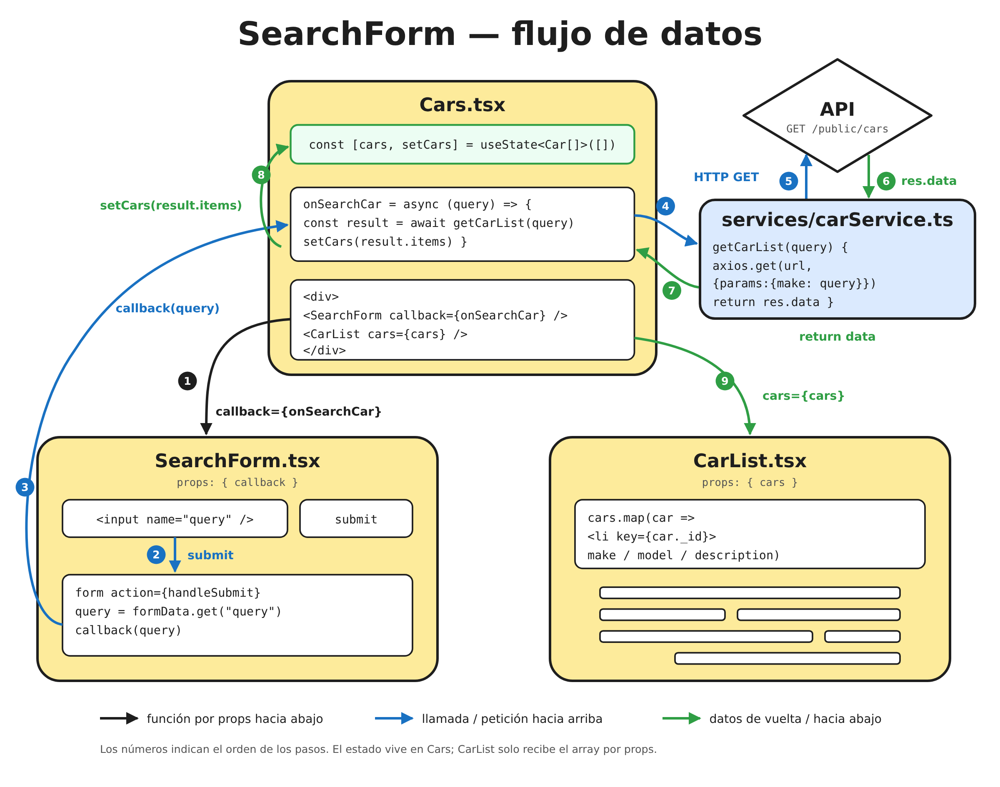

[English](README.md) | [Русский](README.ru.md) | [Українська](README.uk.md) | **Español**

# ⚛️ React — repositorio de aprendizaje

Mi repositorio personal para aprender React. Aquí está todo lo que estudio de
React: teoría, práctica y tareas para volver a resolver, todo en un mismo lugar.

## Cómo está organizado el repositorio

### `main` — aprendizaje actual

Aquí subo lo que estoy estudiando en el curso ahora mismo. Cada carpeta en
`src/components` es una etapa de aprendizaje en forma de mini-proyecto: solo
práctica y código, sin explicaciones teóricas. La lista crece a medida que avanzo.

| Carpeta                       | Qué se practica                                                             |
| ----------------------------- | --------------------------------------------------------------------------- |
| `src/components/Theory-pr`    | Componentes y props tipadas, variantes con `clsx`, CSS Modules, `react-icons` |
| `src/components/Theory-pr2`   | `useState`: componente `Counter` con estado independiente en cada instancia |
| `src/components/Cocktails-pr` | Página de cócteles: componentes anidados, renderizado de listas con `map()` |
| `src/components/ModalExample` | Ventana modal: abrir/cerrar con un `useState` booleano, pasar una función por props |
| `src/components/SearchForm`   | Búsqueda de coches: `action` del formulario + `FormData`, pasar datos hacia arriba con un callback por props, petición a la API con `axios` |

#### `Cocktails-pr` — cómo está hecha la página de cócteles

**Idea.** La página se divide en componentes pequeños, cada uno con una sola
responsabilidad. La lista de cócteles no se escribe a mano: un array de datos
pasa por `map()` y cada elemento se convierte en una tarjeta.

**Especificación técnica:**

- `App` arma la página con tres bloques: `Header`, `CocktailList`, `Footer`.
- `Header` se compone de `Logo` y `Navigation`. `Navigation` renderiza los
  elementos `NavigationItem` del array `nav` con `map()`.
- `CocktailList` contiene el array `coctails` (objetos con `_id`, `drink`,
  `drinkThumb`, `description`), toma los primeros 8 con `slice(0, 8)` y
  convierte cada uno en un `CocktailCard` con `map()`.
- Cada tarjeta tiene un `key={el._id}` único para que React siga los elementos
  de la lista.
- `CocktailList` pasa los datos a `CocktailCard` por props: `title`, `img`,
  `desc`. Las props están tipadas con `interface CocktailCardProps`.
- `CocktailCard` renderiza un `<li>` con imagen, título y descripción; el `alt`
  de la imagen es el nombre del cóctel.
- Cada componente tiene su propio CSS Module al lado.

#### `ModalExample` — cómo funciona el modal

**Idea.** Abrir y cerrar un modal se reduce a un booleano en el estado:
`const [isOpen, setOpen] = useState(false)`. `true` — el modal se muestra,
`false` — se oculta. El renderizado condicional `{isOpen && <Modal ... />}`
lo añade a la página o lo quita.

**Especificación técnica:**

- El estado (`isOpen`) y dos manejadores viven en `App`: `handleOpen` →
  `setOpen(true)`, `handleClose` → `setOpen(false)`.
- El botón «Open Modal» llama a `handleOpen`.
- `App` pasa `handleClose` a `Modal` mediante la prop `onClose`. El modal no
  es dueño del estado: solo recibe una función para «pedirle» al padre que lo
  cierre.
- En `Modal` la prop está tipada con `interface ModalProps { onClose: () => void }`
  y asignada al botón de cerrar: `onClick={onClose}`.
- Maquetación: `backdrop` cubre toda la pantalla con un fondo semitransparente,
  `modal` se centra con flexbox; los estilos están en CSS Modules.

#### `SearchForm` — cómo funciona la búsqueda de coches



**Idea.** El formulario no sabe nada de coches: solo recoge la consulta y se la
entrega al padre mediante un callback, así que se puede reutilizar en cualquier
sitio. El padre `Cars` es dueño del estado, llama a la API a través de un
servicio aparte y pasa el resultado hacia abajo a la lista.

**Especificación técnica:**

- `App` renderiza `Cars`.
- En `Cars` viven el estado `const [cars, setCars] = useState<Car[]>([])` y el
  manejador `onSearchCar(query)`.
- `Cars` pasa `onSearchCar` a `SearchForm` mediante la prop `callback`, y el
  array `cars` a `CarList` mediante la prop `cars`.
- `SearchForm` usa una action de formulario de React 19: `<form action={handleSubmit}>`.
  `handleSubmit(formData)` lee el valor con `formData.get("query")` (el input
  tiene `name="query"`) y llama a `callback(query)`. Las props están tipadas con
  `interface SearchFormProps { callback: (query: string) => void }`.
- `onSearchCar` es `async`: espera a `getCarList(query)` y luego llama a
  `setCars(result.items)`.
- `getCarList` está en `services/carService.ts`, no en el componente: envía
  `axios.get` a `/public/cars` con `params: { make: query }` y devuelve
  `res.data`. La respuesta está tipada con `GetCarListResponse` (campos de
  paginación + `items: Car[]`). El tipo `Car` está en `types/cars.ts`.
- `CarList` no tiene estado: recibe el array `cars` y con `map()` renderiza
  `<li key={car._id}>` con `make`, `model` y `description`.
- Tras `setCars`, React vuelve a renderizar `Cars` y `CarList` recibe el nuevo
  array.
- Cada componente tiene su propio CSS Module al lado.

### Ramas — tareas para volver a resolver

En ramas separadas guardo tareas y componentes a los que quiero volver y
resolver de nuevo para afianzar lo aprendido. Las ramas **nunca se fusionan**
con `main`.

- **`task-XX-nombre`** — el enunciado de la tarea (README) sobre una plantilla
  limpia. Esta rama no la modifico.

## Tareas

| #  | Tarea                                      | Rama                                                                                       | Temas                                                              |
| -- | ------------------------------------------ | ------------------------------------------------------------------------------------------ | ------------------------------------------------------------------ |
| 01 | Widget de opiniones (Sip Happens Café)     | [`task-01-cafe-feedback`](https://github.com/mrkorzun/react/tree/task-01-cafe-feedback) | componentes, props, `useState`, tipado, renderizado condicional |
| 02 | Búsqueda de películas (TMDB)               | [`task-02-movie-search`](https://github.com/mrkorzun/react/tree/task-02-movie-search)   | `axios`, variables de entorno, Form Actions, `react-hot-toast`, `createPortal`, `useEffect` |

> La lista completa de ramas con tareas está en esta tabla. Nueva tarea = nueva fila.
> Cómo resolver una tarea y cómo añadir una nueva se describe en el README de
> cada rama de tarea.

## ¿Quieres resolver una tarea y enseñármela?

Estaré encantado de revisar tu solución. Así se hace:

1. Haz un **Fork** de este repositorio (botón arriba a la derecha en GitHub).
2. Clona tu fork y cambia a la rama de la tarea:
   ```bash
   git clone https://github.com/<tu-usuario>/react.git
   cd react
   git checkout task-01-cafe-feedback
   git checkout -b task-01-cafe-feedback-<tu-usuario>
   ```
3. Resuelve la tarea siguiendo su README, haz commit y sube la rama a tu fork:
   ```bash
   git push -u origin task-01-cafe-feedback-<tu-usuario>
   ```
4. Abre un **Pull Request** a este repositorio:
   - **base:** `task-01-cafe-feedback` (la rama de la tarea, **no** `main`);
   - **compare:** tu rama del fork;
   - título: `Solución task-01 — <tu-usuario>`.
5. Revisaré el código y dejaré comentarios directamente en el PR.

Los PR **no se fusionan**, para que la rama de la tarea siga limpia para futuros
intentos. Tras la revisión cerraré el PR y tu solución seguirá en tu fork.

## Stack

- React 19 + TypeScript
- Vite
- CSS Modules + `modern-normalize`
- ESLint, Prettier
- `clsx`, `react-icons`, `axios`

## Scripts

| Comando           | Qué hace                            |
| ----------------- | ----------------------------------- |
| `npm run dev`     | inicia el servidor de desarrollo    |
| `npm run build`   | comprueba tipos y compila           |
| `npm run preview` | vista previa del build de producción |
| `npm run lint`    | ejecuta ESLint                      |

---

> **Sobre los colaboradores.** Claude (el asistente de IA de Anthropic) aparece
> entre los colaboradores solo porque ayudó a redactar y traducir los archivos
> README. Todo el código de este repositorio lo he escrito yo.
