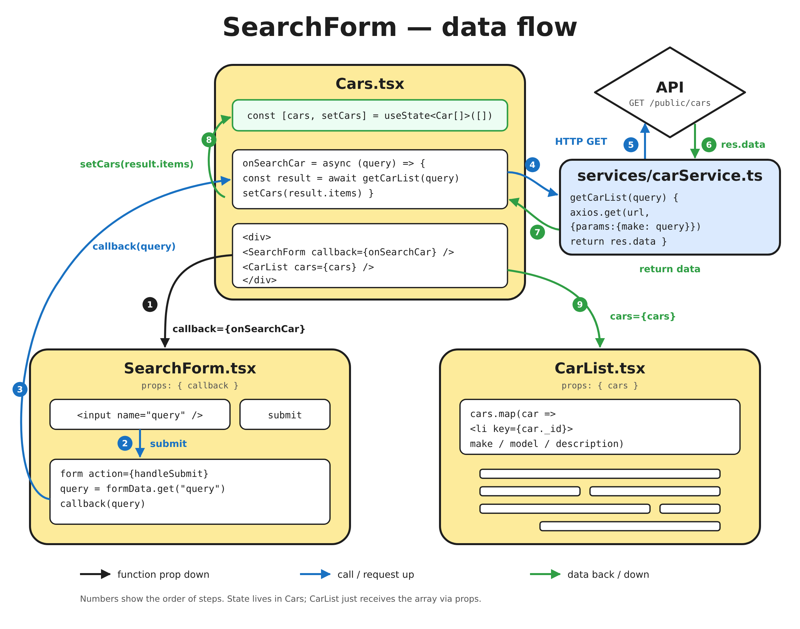

**English** | [Русский](README.ru.md) | [Українська](README.uk.md) | [Español](README.es.md)

# ⚛️ React — learning repository

My personal repository for learning React. Everything I study about React lives
here: theory, practice and tasks to solve again, all in one place.

## How the repository is organized

### `main` — current learning

This is where I push what I'm studying in the course right now. Each folder in
`src/components` is a learning stage built as a mini-project: practical code
only, no theory notes. The list grows as I progress.

| Folder                        | What's practiced                                                        |
| ----------------------------- | ----------------------------------------------------------------------- |
| `src/components/Theory-pr`    | Components and typed props, `clsx` variants, CSS Modules, `react-icons` |
| `src/components/Theory-pr2`   | `useState`: `Counter` component with independent state per instance     |
| `src/components/Cocktails-pr` | Cocktails page: nested components, rendering lists with `map()`         |
| `src/components/ModalExample` | Modal window: open/close with a boolean `useState`, passing a callback via props |
| `src/components/SearchForm`   | Car search: form `action` + `FormData`, passing data up via a callback prop, API request with `axios` |

#### `Cocktails-pr` — how the cocktails page works

**Idea.** The page is split into small components, each responsible for one
thing. The cocktail list isn't written by hand: an array of data goes through
`map()`, and every element becomes a card.

**Technical spec:**

- `App` assembles the page from three blocks: `Header`, `CocktailList`, `Footer`.
- `Header` is made of nested components: `Logo` and `Navigation`. `Navigation`
  renders `NavigationItem` items from the `nav` array via `map()`.
- `CocktailList` holds the `coctails` array (objects with `_id`, `drink`,
  `drinkThumb`, `description`), takes the first 8 with `slice(0, 8)` and turns
  each into a `CocktailCard` via `map()`.
- Each card gets a unique `key={el._id}` so React can track list items.
- `CocktailList` passes data to `CocktailCard` through props: `title`, `img`,
  `desc`. Props are typed via `interface CocktailCardProps`.
- `CocktailCard` renders `<li>` with an image, a title and a description; the
  image's `alt` is the cocktail name.
- Every component has its own CSS Module next to it.

#### `ModalExample` — how the modal works

**Idea.** Opening and closing a modal comes down to one boolean in state:
`const [isOpen, setOpen] = useState(false)`. `true` — the modal is shown,
`false` — it's hidden. Conditional rendering `{isOpen && <Modal ... />}` adds
the modal to the page or removes it.

**Technical spec:**

- `App` owns the state (`isOpen`) and two handlers: `handleOpen` →
  `setOpen(true)`, `handleClose` → `setOpen(false)`.
- The "Open Modal" button calls `handleOpen`.
- `App` passes `handleClose` to `Modal` through the `onClose` prop. The modal
  doesn't own the state — it only gets a function to "ask" the parent to close it.
- In `Modal` the prop is typed via `interface ModalProps { onClose: () => void }`
  and attached to the close button: `onClick={onClose}`.
- Layout: `backdrop` covers the whole screen with a semi-transparent background,
  `modal` is centered with flexbox; styles live in CSS Modules.

#### `SearchForm` — how the car search works



**Idea.** The form knows nothing about cars: it only collects the query and
hands it to the parent through a callback, so it can be reused anywhere. The
parent `Cars` owns the state, calls the API through a separate service and
passes the result down to the list.

**Technical spec:**

- `App` renders `Cars`.
- `Cars` owns the state `const [cars, setCars] = useState<Car[]>([])` and the
  handler `onSearchCar(query)`.
- `Cars` passes `onSearchCar` to `SearchForm` through the `callback` prop, and
  the `cars` array to `CarList` through the `cars` prop.
- `SearchForm` uses a React 19 form action: `<form action={handleSubmit}>`.
  `handleSubmit(formData)` reads the value with `formData.get("query")` (the
  input has `name="query"`) and calls `callback(query)`. Props are typed via
  `interface SearchFormProps { callback: (query: string) => void }`.
- `onSearchCar` is `async`: it waits for `getCarList(query)` and then calls
  `setCars(result.items)`.
- `getCarList` lives in `services/carService.ts`, not in the component: it
  sends `axios.get` to `/public/cars` with `params: { make: query }` and returns
  `res.data`. The response is typed via `GetCarListResponse` (pagination fields
  + `items: Car[]`). The `Car` type lives in `types/cars.ts`.
- `CarList` doesn't own any state: it gets the `cars` array and renders
  `<li key={car._id}>` with `make`, `model` and `description` via `map()`.
- After `setCars` React re-renders `Cars`, and `CarList` receives the new array.
- Every component has its own CSS Module next to it.

### Branches — tasks for re-solving

Separate branches hold tasks and components I want to come back to and solve
again to reinforce what I've learned. Branches are **never merged** into `main`.

- **`task-XX-name`** — the task description (README) on a clean template. I
  don't change this branch.

## Tasks

| #  | Task                               | Branch                                                                                     | Topics                                                     |
| -- | ---------------------------------- | ------------------------------------------------------------------------------------------ | ---------------------------------------------------------- |
| 01 | Feedback widget (Sip Happens Café) | [`task-01-cafe-feedback`](https://github.com/mrkorzun/react/tree/task-01-cafe-feedback) | components, props, `useState`, typing, conditional rendering |
| 02 | Movie search (TMDB)                | [`task-02-movie-search`](https://github.com/mrkorzun/react/tree/task-02-movie-search)   | `axios`, env variables, Form Actions, `react-hot-toast`, `createPortal`, `useEffect` |

> The full list of task branches is in this table. New task = new row.
> How to solve a task and how to add a new one is described in each task
> branch's README.

## Want to solve a task and show me?

I'd be happy to review your solution. Here's how:

1. **Fork** this repository (button at the top right on GitHub).
2. Clone your fork and switch to the task branch:
   ```bash
   git clone https://github.com/<your-username>/react.git
   cd react
   git checkout task-01-cafe-feedback
   git checkout -b task-01-cafe-feedback-<your-username>
   ```
3. Solve the task following its README, then commit and push the branch to your fork:
   ```bash
   git push -u origin task-01-cafe-feedback-<your-username>
   ```
4. Open a **Pull Request** to this repository:
   - **base:** `task-01-cafe-feedback` (the task branch, **not** `main`);
   - **compare:** your branch from the fork;
   - title: `Solution task-01 — <your-username>`.
5. I'll review the code and leave comments right in the PR.

PRs are **not merged**, so the task branch stays clean for future attempts.
After the review I'll close the PR, and your solution stays in your fork.

## Stack

- React 19 + TypeScript
- Vite
- CSS Modules + `modern-normalize`
- ESLint, Prettier
- `clsx`, `react-icons`, `axios`

## Scripts

| Command           | What it does                  |
| ----------------- | ----------------------------- |
| `npm run dev`     | start the dev server          |
| `npm run build`   | type-check and build          |
| `npm run preview` | preview the production build  |
| `npm run lint`    | run ESLint                    |

---

> **About contributors.** Claude (Anthropic's AI assistant) appears among the
> contributors only because it helped write and translate the README files. All
> code in this repository is written by me.
