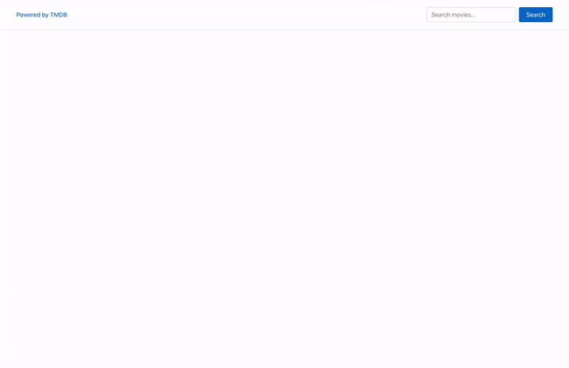
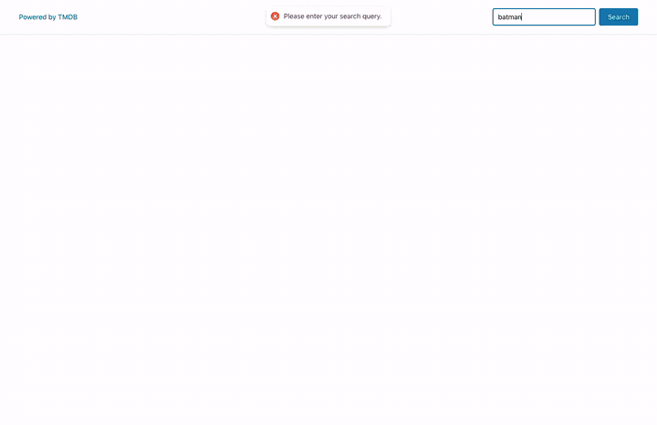

<p align="center">
  <b>English</b> | <a href="README.ru.md">Русский</a> | <a href="README.uk.md">Українська</a> | <a href="README.es.md">Español</a>
</p>


# Movie search — TMDB

<p align="center">
  
</p>

## About the project

A single-page app for searching movies by keyword. The user types a query, the
app sends an HTTP request to [TMDB](https://www.themoviedb.org/) and shows a
grid of posters. Clicking a poster opens a modal window with the backdrop
image, description, release date and rating. While the request is in progress,
a loader is shown; on a network error — an error message; for an empty query
or an empty result — a toast notification.


### What you'll practice

| Skill                               | Where it's used in the task                                            |
| ----------------------------------- | ---------------------------------------------------------------------- |
| HTTP requests with `axios`          | `fetchMovies` in `src/services/movieService.ts`                        |
| Authorization header, env variables | `Authorization: Bearer ...` from `VITE_TMDB_TOKEN`                     |
| Typing API responses                | `Movie`, `FetchMoviesResponse`, `axios.get<FetchMoviesResponse>`       |
| `async/await`, `try/catch/finally`  | search handler in `App`                                                |
| React 19 Form Actions               | `<form action={handleSubmit}>` + `formData.get("query")` in `SearchBar` |
| Several pieces of state             | `movies`, `isLoading`, `isError`, `selectedMovie` in `App`             |
| Conditional rendering               | `Loader`, `ErrorMessage`, `MovieGrid`, `MovieModal`                    |
| Toast notifications                 | `react-hot-toast`: empty query and "no movies found"                   |
| Callback props with arguments       | `onSubmit(query)`, `onSelect(movie)`, `onClose()`                      |
| Portals                             | `MovieModal` is rendered into `document.body` via `createPortal`       |
| `useEffect` with cleanup            | ESC listener and `body` scroll lock in `MovieModal`                    |
| CSS Modules                         | ready `*.module.css` for every component                               |

---

## Task

Build an app that searches movies by keyword using the TMDB API.

> 💡 No need to write your own styles — just focus on React and TypeScript logic.

The markup is already done: all components with JSX and styles are in the
branch,
so you go straight to the **React and TypeScript logic** — HTTP requests,
state, props, typing, conditional rendering and the modal window.

## What's already in the starter

<p align="center">
  
</p>

```
src/
├── components/
│   ├── App/            App.tsx, App.module.css                    ← renders the components
│   ├── SearchBar/      SearchBar.tsx, SearchBar.module.css        ← header with the search form
│   ├── MovieGrid/      MovieGrid.tsx, MovieGrid.module.css        ← markup of the grid (one example card)
│   ├── Loader/         Loader.tsx, Loader.module.css              ← "Loading movies, please wait..."
│   ├── ErrorMessage/   ErrorMessage.tsx, ErrorMessage.module.css  ← "There was an error, please try again..."
│   └── MovieModal/     MovieModal.tsx, MovieModal.module.css      ← markup of the modal (not rendered yet)
└── types/
    └── movie.ts                                                   ← Movie interface
.env.example                                                       ← template for VITE_TMDB_TOKEN
```

- Every component has ready JSX markup and its own CSS module.
- `App` renders `SearchBar`, `Loader`, `ErrorMessage` and `MovieGrid` all at
  once — there is no logic yet. `MovieModal` is imported but commented out,
  because the backdrop would cover the whole page.
- `axios` and `react-hot-toast` are already in `package.json`.
- `src/types/movie.ts` already exports the movie type:

  ```ts
  export interface Movie {
    id: number;
    poster_path: string;
    backdrop_path: string;
    title: string;
    overview: string;
    release_date: string;
    vote_average: number;
  }
  ```

## General requirements

- Don't change the markup and styles — only add logic, props and types.
- Components are exported with a default export (`export default`).
- Shared types live in `src/types`. Types and interfaces that belong to a
  single component (for example, props) are declared directly in that
  component's file.
- Never put the access token in the code — only in the `VITE_TMDB_TOKEN`
  environment variable. The `.env` file is already in `.gitignore`.
- TypeScript code must be clean, readable and formatted with Prettier.

---

## Step 1. TMDB access token

1. Sign up at [themoviedb.org](https://www.themoviedb.org/signup) and confirm
   your email.
2. Open **Settings → API**, create an application (type — *Developer*, usage —
   personal/educational) and fill in the form.
3. Copy the **API Read Access Token** (the long JWT string, not the short API Key).
4. Create a `.env` file in the project root based on `.env.example`:

   ```bash
   VITE_TMDB_TOKEN=your_tmdb_read_access_token
   ```

5. Restart `npm run dev` — Vite reads `.env` only at startup. In code the token
   is available as `import.meta.env.VITE_TMDB_TOKEN`.

Useful documentation:
[authentication](https://developer.themoviedb.org/docs/authentication-application),
[search movies](https://developer.themoviedb.org/reference/search-movie),
[building image URLs](https://developer.themoviedb.org/docs/image-basics).

## Step 2. `fetchMovies` service

Create `src/services/movieService.ts` with a `fetchMovies` function:

- it takes the search query (`string`) and returns `Promise<Movie[]>`;
- it sends `GET https://api.themoviedb.org/3/search/movie`;
- describe the response with a `FetchMoviesResponse` interface (at least
  `results: Movie[]`) and pass it to axios: `axios.get<FetchMoviesResponse>(...)`.

The axios config object looks like this:

```ts
{
  params: {
    query, // your parameters
  },
  headers: {
    Authorization: `Bearer ${import.meta.env.VITE_TMDB_TOKEN}`,
  },
}
```

> Check the result in the console before wiring the UI: call `fetchMovies("batman")`
> once and make sure you get an array of movies.

## Step 3. `SearchBar` — Form Actions and validation

| Prop       | Type                      | Description                         |
| ---------- | ------------------------- | ----------------------------------- |
| `onSubmit` | `(query: string) => void` | passes the input value to the parent |

- Declare a `SearchBarProps` interface in the component file.
- Handle the form with **Form Actions**: `<form action={handleSubmit}>`, where
  `handleSubmit(formData: FormData)` reads `formData.get("query")`.
- If the field is empty (after `trim()`), show the toast
  `Please enter your search query.` and don't call `onSubmit`.
- This check lives in `SearchBar`. Add `<Toaster />` from `react-hot-toast`
  once in `App`, otherwise the toasts won't be visible.

After this step the app should work like this:



## Step 4. Search in `App` and `MovieGrid`

In `App` create the `movies` state (`Movie[]`) and a search handler that you
pass to `SearchBar` via `onSubmit`. The handler:

1. clears the previous collection (`setMovies([])`) — every new search starts
   from scratch;
2. calls `fetchMovies(query)` and saves the result into `movies`.

Add props to `MovieGrid`:

| Prop       | Type                     | Description                     |
| ---------- | ------------------------ | ------------------------------- |
| `movies`   | `Movie[]`                | the array of movies             |
| `onSelect` | `(movie: Movie) => void` | called when a card is clicked   |

- Declare a `MovieGridProps` interface.
- Render one `<li key={movie.id}>` per movie with `map()`.
- Poster URL: `https://image.tmdb.org/t/p/w500${movie.poster_path}`, `alt` —
  the movie title.
- `MovieGrid` is rendered **only when** `movies.length > 0`.

After this step the app should work like this:



## Step 5. `Loader` and `ErrorMessage`

Add the `isLoading` and `isError` states (`boolean`) to `App`.

- Before the request: `isLoading = true`, `isError = false`.
- Wrap the request in `try/catch/finally`: in `catch` set `isError = true`, in
  `finally` — `isLoading = false`.
- `Loader` is rendered **instead of** the grid while the request is in progress.
- `ErrorMessage` is rendered **instead of** the grid if the request failed.

> To check `ErrorMessage`, temporarily break the token in `.env` and restart
> the dev server.

## Step 6. "No movies found" notification

If the request succeeded but the array is empty, show the toast
`No movies found for your request.` This check lives in `App`, in the search
handler.

After this step the app should work like this:


## Step 7. `MovieModal`

Clicking a card opens a modal with details about the movie.

In `App`:

- create the `selectedMovie` state (`Movie | null`);
- pass `setSelectedMovie` (or a wrapper) to `MovieGrid` as `onSelect`;
- render `MovieModal` only when `selectedMovie` is not `null`;
- closing the modal resets `selectedMovie` to `null`.

`MovieModal` props:

| Prop      | Type         | Description                       |
| --------- | ------------ | --------------------------------- |
| `movie`   | `Movie`      | the selected movie                |
| `onClose` | `() => void` | closes the modal                  |

Requirements:

- the modal is rendered outside the main tree via `createPortal(..., document.body)`;
- it closes on the **×** button, on **Escape** and on a click on the backdrop
  (but not on the modal itself — compare `event.target` and `event.currentTarget`);
- while it's open, page scrolling is disabled (`document.body.style.overflow = "hidden"`);
- backdrop image: `https://image.tmdb.org/t/p/original${movie.backdrop_path}`;
- replace the placeholders with `title`, `overview`, `release_date` and
  `vote_average` (format: `7.2/10`).

> **Cleanup is mandatory.** Add the `keydown` listener and lock scrolling in
> `useEffect`, and in the function it returns remove the listener and restore
> `overflow`. Closing must leave nothing behind.

After this step the app is complete and should work like this:


---

## Submitting for review

Solved the task and want me to review it? Here are the steps and requirements.

**Requirements for the solution**

- [ ] All steps 1–7 are done and every item in the checklist below is ticked.
- [ ] The token is **not** in the code or in the commits — only in a local `.env`.
- [ ] `npm run build` and `npm run lint` pass without errors.
- [ ] Code is formatted with Prettier.
- [ ] The app is checked in the browser: search, toasts, loader, error, grid and modal work.
- [ ] *(Optional)* The app is deployed (Vercel / Netlify) with `VITE_TMDB_TOKEN`
      set in the hosting settings, and the link is added to the PR.

**How to submit**

1. **Fork** this repository (button at the top right on GitHub).
2. Clone your fork and create your branch from the task branch:
   ```bash
   git clone https://github.com/<your-username>/react.git
   cd react
   git checkout task-02-movie-search
   git checkout -b task-02-movie-search-<your-username>
   npm install
   cp .env.example .env   # and paste your token
   npm run dev
   ```
3. Solve the task, commit and push the branch to your fork:
   ```bash
   git push -u origin task-02-movie-search-<your-username>
   ```
4. Open a **Pull Request** to this repository:
   - **base:** `task-02-movie-search` (the task branch, **not** `main`);
   - **compare:** your branch from the fork;
   - title: `Solution task-02 — <your-username>`;
   - fill in the PR template (it appears automatically).
5. I'll review the code and leave comments right in the PR.

The PR is **not merged**, so the task branch stays clean for future attempts.
After the review I'll close it, and your solution stays in your fork.

## Checklist

- [ ] Step 1 — TMDB token in `.env`
- [ ] Step 2 — `fetchMovies` in `services/movieService.ts`, typed response
- [ ] Step 3 — `SearchBar`: Form Actions, `onSubmit`, empty query toast
- [ ] Step 4 — `movies` state, search handler, `MovieGrid`
- [ ] Step 5 — `Loader` and `ErrorMessage`
- [ ] Step 6 — "No movies found" toast
- [ ] Step 7 — `MovieModal`: portal, ×/ESC/backdrop, scroll lock, cleanup
