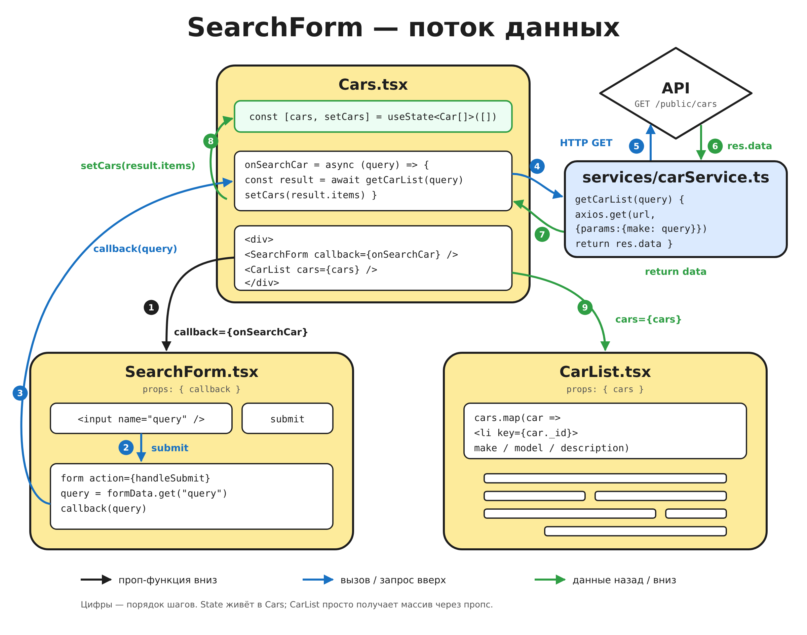

[English](README.md) | **Русский** | [Українська](README.uk.md) | [Español](README.es.md)

# ⚛️ React — учебный репозиторий

Личный репозиторий для изучения React. Здесь собрано всё, что я прохожу по React:
теория, практика и задачи для повторного решения, всё в одном месте.

## Как устроен репозиторий

### `main` — текущее обучение

Сюда я пушу то, что прохожу на курсе прямо сейчас. Каждая папка в
`src/components` — это этап обучения в виде мини-проекта: только практика и
код, без теоретических объяснений. Список пополняется по мере прохождения.

| Папка                         | Что отрабатывается                                                          |
| ----------------------------- | --------------------------------------------------------------------------- |
| `src/components/Theory-pr`    | Компоненты и типизированные пропсы, варианты через `clsx`, CSS-модули, `react-icons` |
| `src/components/Theory-pr2`   | `useState`: компонент `Counter` с независимым состоянием у каждого экземпляра |
| `src/components/Cocktails-pr` | Страница коктейлей: вложенные компоненты, рендер списков через `map()`      |
| `src/components/ModalExample` | Модальное окно: открытие/закрытие через булевый `useState`, передача функции через пропсы |
| `src/components/SearchForm`   | Поиск машин: `action` формы + `FormData`, передача данных наверх через колбэк-пропс, запрос к API через `axios` |

#### `Cocktails-pr` — как устроена страница коктейлей

**Идея.** Страница разбита на маленькие компоненты, каждый отвечает за что-то
одно. Список коктейлей не пишется вручную: массив данных проходит через
`map()`, и каждый элемент превращается в карточку.

**Техническая спецификация:**

- `App` собирает страницу из трёх блоков: `Header`, `CocktailList`, `Footer`.
- `Header` состоит из вложенных компонентов `Logo` и `Navigation`.
  `Navigation` рендерит пункты `NavigationItem` из массива `nav` через `map()`.
- В `CocktailList` лежит массив `coctails` (объекты с `_id`, `drink`,
  `drinkThumb`, `description`). Через `slice(0, 8)` берутся первые 8, и каждый
  превращается в `CocktailCard` через `map()`.
- У каждой карточки уникальный `key={el._id}`, чтобы React отслеживал элементы
  списка.
- `CocktailList` передаёт данные в `CocktailCard` через пропсы: `title`, `img`,
  `desc`. Пропсы типизированы через `interface CocktailCardProps`.
- `CocktailCard` рендерит `<li>` с картинкой, заголовком и описанием; `alt`
  картинки — название коктейля.
- У каждого компонента рядом свой CSS-модуль.

#### `ModalExample` — как работает модалка

**Идея.** Открытие и закрытие модалки сводится к одному булю в состоянии:
`const [isOpen, setOpen] = useState(false)`. `true` — модалка показана,
`false` — скрыта. Условный рендер `{isOpen && <Modal ... />}` добавляет её на
страницу или убирает.

**Техническая спецификация:**

- Состояние (`isOpen`) и два обработчика живут в `App`: `handleOpen` →
  `setOpen(true)`, `handleClose` → `setOpen(false)`.
- Кнопка «Open Modal» вызывает `handleOpen`.
- `App` передаёт `handleClose` в `Modal` через пропс `onClose`. Сама модалка
  состоянием не владеет — она получает только функцию, чтобы «попросить»
  родителя закрыть её.
- В `Modal` пропс типизирован через `interface ModalProps { onClose: () => void }`
  и навешан на кнопку закрытия: `onClick={onClose}`.
- Вёрстка: `backdrop` закрывает весь экран полупрозрачным фоном, `modal`
  центрируется через flexbox; стили — в CSS-модулях.

#### `SearchForm` — как работает поиск машин



**Идея.** Форма ничего не знает про машины: она только собирает запрос и
отдаёт его родителю через колбэк, поэтому её можно переиспользовать где угодно.
Родитель `Cars` владеет состоянием, ходит в API через отдельный сервис и
передаёт результат вниз в список.

**Техническая спецификация:**

- `App` рендерит `Cars`.
- В `Cars` живут состояние `const [cars, setCars] = useState<Car[]>([])` и
  обработчик `onSearchCar(query)`.
- `Cars` передаёт `onSearchCar` в `SearchForm` через пропс `callback`, а массив
  `cars` в `CarList` через пропс `cars`.
- `SearchForm` использует action формы из React 19: `<form action={handleSubmit}>`.
  `handleSubmit(formData)` достаёт значение через `formData.get("query")` (у
  инпута `name="query"`) и вызывает `callback(query)`. Пропсы типизированы через
  `interface SearchFormProps { callback: (query: string) => void }`.
- `onSearchCar` — `async`: ждёт `getCarList(query)` и потом вызывает
  `setCars(result.items)`.
- `getCarList` лежит в `services/carService.ts`, а не в компоненте: отправляет
  `axios.get` на `/public/cars` с `params: { make: query }` и возвращает
  `res.data`. Ответ типизирован через `GetCarListResponse` (поля пагинации +
  `items: Car[]`). Тип `Car` описан в `types/cars.ts`.
- `CarList` состоянием не владеет: получает массив `cars` и через `map()`
  рендерит `<li key={car._id}>` с `make`, `model` и `description`.
- После `setCars` React перерисовывает `Cars`, и `CarList` получает новый массив.
- У каждого компонента рядом свой CSS-модуль.

### Ветки — задачи для повторного прохождения

В отдельных ветках хранятся задачи и компоненты, к которым я хочу вернуться и
решить заново, чтобы закрепить материал. Ветки **не мерджатся** в `main`.

- **`task-XX-название`** — условие задачи (README) на чистом шаблоне. Эту ветку
  я не меняю.

## Задачи

| №  | Задача                         | Ветка                                                                                      | Темы                                                |
| -- | ------------------------------ | ------------------------------------------------------------------------------------------ | --------------------------------------------------- |
| 01 | Віджет відгуків (Sip Happens Café) | [`task-01-cafe-feedback`](https://github.com/mrkorzun/react/tree/task-01-cafe-feedback) | компоненты, пропсы, `useState`, типизация, условный рендеринг |

> Полный список веток с задачами — в этой таблице. Новая задача = новая строка.
> Как решать задачу и как добавить новую — описано в README каждой ветки задачи.

## Хочешь решить задачу и показать мне?

Буду рад проверить твоё решение. Как это сделать:

1. Сделай **Fork** этого репозитория (кнопка справа вверху на GitHub).
2. Склонируй свой форк и перейди в ветку задачи:
   ```bash
   git clone https://github.com/<твой-ник>/react.git
   cd react
   git checkout task-01-cafe-feedback
   git checkout -b task-01-cafe-feedback-<твой-ник>
   ```
3. Реши задачу по README, закоммить и запушь ветку в свой форк:
   ```bash
   git push -u origin task-01-cafe-feedback-<твой-ник>
   ```
4. Открой **Pull Request** в этот репозиторий:
   - **base:** `task-01-cafe-feedback` (ветка задачи, **не** `main`);
   - **compare:** твоя ветка из форка;
   - в названии укажи: `Решение task-01 — <твой-ник>`.
5. Я посмотрю код и оставлю комментарии прямо в PR.

PR **не мерджится**, чтобы ветка задачи осталась чистой для следующих
прохождений. После ревью я закрою PR, а твоё решение останется в твоём форке.

## Стек

- React 19 + TypeScript
- Vite
- CSS Modules + `modern-normalize`
- ESLint, Prettier
- `clsx`, `react-icons`, `axios`

## Скрипты

| Команда           | Что делает                    |
| ----------------- | ----------------------------- |
| `npm run dev`     | запуск dev-сервера            |
| `npm run build`   | проверка типов и сборка       |
| `npm run preview` | просмотр production-сборки    |
| `npm run lint`    | проверка ESLint               |

---

> **О контрибьюторах.** Claude (ИИ-ассистент от Anthropic) указан среди
> контрибьюторов только потому, что помогал писать и переводить README-файлы.
> Весь код в этом репозитории написан мной.
