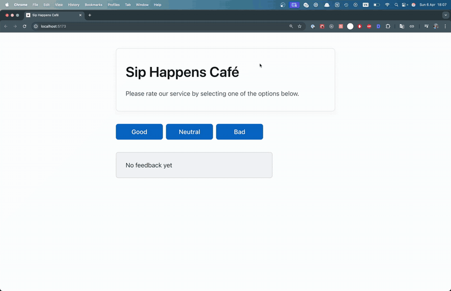
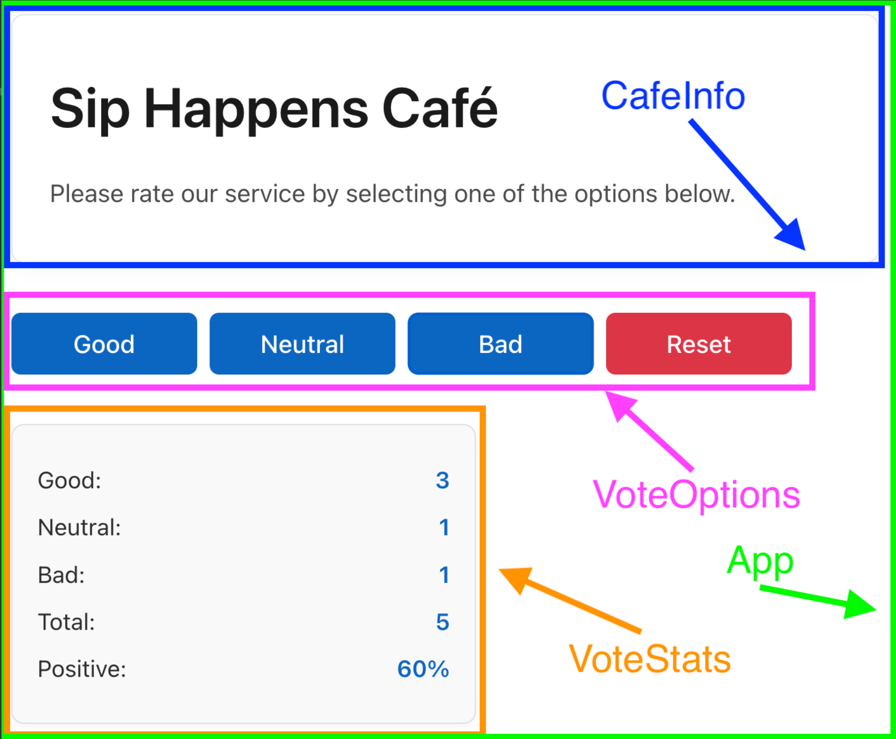
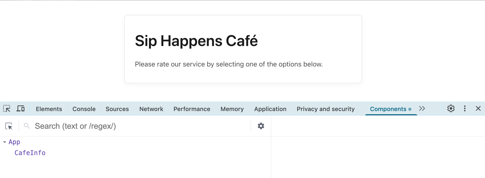

[English](README.md) | **Русский** | [Українська](README.uk.md) | [Español](README.es.md)

# Виджет отзывов — Sip Happens Café

## Как решать задачу

```bash
# 1. склонировать репозиторий (один раз)
git clone https://github.com/mrkorzun/react.git
cd react

# 2. открыть проект в VS Code
code .

# 3. перейти в ветку задачи
git checkout task-01-cafe-feedback

# 4. создать свою ветку для попытки
git checkout -b task-01-cafe-feedback-try1

# 5. установить зависимости и запустить dev-сервер
npm install
npm run dev
```

После этого открой в браузере http://localhost:5173.

```bash
# уже клонировал? просто подтяни свежие ветки
git fetch origin
git checkout task-01-cafe-feedback

# вернуть попытку к условию, если хочется начать заново
git reset --hard task-01-cafe-feedback
```

## О проекте

Одностраничное приложение: посетитель оценивает кофейню (**Good / Neutral / Bad**)
и сразу видит статистику — количество голосов по каждому варианту, общее число
голосов и процент положительных отзывов. Пока голосов нет, показывается
сообщение «No feedback yet»; кнопка **Reset** появляется только после первого
голоса и сбрасывает результаты.

**Уровень:** начальный · первое приложение на React + TypeScript

### Демо

Как должно выглядеть и работать готовое приложение (прокликан весь функционал):



### Что прокачиваешь

| Навык                              | Где используется в задаче                                        |
| ---------------------------------- | ---------------------------------------------------------------- |
| Функциональные компоненты и JSX    | `App`, `CafeInfo`, `VoteOptions`, `VoteStats`, `Notification`    |
| Композиция компонентов             | все компоненты рендерятся внутри `App`                           |
| Пропсы                             | передача данных и колбэков из `App` в дочерние компоненты        |
| Типизация пропсов (`interface`)    | `VoteOptionsProps`, `VoteStatsProps`                             |
| Общие TS-типы, union-типы          | `Votes`, `VoteType = 'good' \| 'neutral' \| 'bad'` в `src/types` |
| `useState` с объектом              | состояние `votes` `{ good, neutral, bad }`                       |
| Иммутабельное обновление состояния | `handleVote(type)` — spread + вычисляемый ключ `[type]`          |
| Подъём состояния (lifting state up) | состояние в `App`, дети получают его через пропсы               |
| Обработка событий                  | `onClick` на кнопках → `onVote` / `onReset`                      |
| Производные данные                 | `totalVotes` и `positiveRate` вычисляются, а не хранятся         |
| Условный рендеринг                 | `VoteStats` или `Notification`, кнопка Reset через `canReset`    |
| CSS-модули                         | `*.module.css` для каждого компонента, `modern-normalize`        |

---

## Задача

Создай приложение, которое позволяет пользователям оставлять отзывы о кофейне.
Есть три варианта оценки: **good**, **neutral**, **bad**. Пользователь выбирает
один из вариантов и видит статистику.

## Общие требования

- В каждой папке компонента должны быть:
  - файл компонента с расширением `.tsx` (например, `App.tsx`);
  - файл стилей с таким же именем, оканчивающийся на `.module.css`
    (например, `App.module.css`).
- Компоненты экспортируются по умолчанию (`export default`).
- Общие типы, используемые в нескольких компонентах, вынесены в отдельный файл
  `src/types/votes.ts`. Типы и интерфейсы, относящиеся только к одному
  компоненту, объявлены прямо в файле этого компонента.
- TypeScript-код должен быть чистым, понятным и отформатированным с помощью
  Prettier.
- Стилизация выполняется с помощью CSS-модулей.
- Используется `modern-normalize` для унификации стилей в разных браузерах.
- После изменений в репозитории подожди 5 минут перед отправкой работы на
  проверку — GitHub нужно время, чтобы обновить версию.

## Компоненты

Интерфейс уже разделён на компоненты, даны готовая HTML-разметка и стили.
Задача — сосредоточиться на логике в React и TypeScript: собрать интерфейс,
реализовать функциональность и выполнить типизацию.

Стили для всех компонентов скопируй из репозитория
[goitacademy/react-cafe-styles](https://github.com/goitacademy/react-cafe-styles).
После создания компонентов скопируй соответствующие `.module.css` файлы в
соответствующие папки в `src/components`.

Все компоненты рендерятся внутри компонента `App`.



```
src/
├── components/
│   ├── App/            App.tsx, App.module.css
│   ├── CafeInfo/       CafeInfo.tsx, CafeInfo.module.css
│   ├── VoteOptions/    VoteOptions.tsx, VoteOptions.module.css
│   ├── VoteStats/      VoteStats.tsx, VoteStats.module.css
│   └── Notification/   Notification.tsx, Notification.module.css
└── types/
    └── votes.ts
```

---

## Шаг 1. Компонент `App`

`App` — контейнер для остальных компонентов. Пока что создаёт такую разметку:

```jsx
<div className={css.app}></div>
```

## Шаг 2. Компонент `CafeInfo`

Компонент с названием и коротким описанием кофейни:

```jsx
<div className={css.container}>
  <h1 className={css.title}>Sip Happens Café</h1>
  <p className={css.description}>
    Please rate our service by selecting one of the options below.
  </p>
</div>
```

Добавь его в `App`. После этого шага интерфейс должен выглядеть так:



## Шаг 3. Состояние приложения

При клике на кнопки **Good / Neutral / Bad** из компонента `VoteOptions` нужно
сохранять выбор пользователя и передавать его другим компонентам, в частности
`<VoteStats />`.

Создай в `App` состояние `votes`:

```ts
{
  good: 0,
  neutral: 0,
  bad: 0
}
```

Типизируй состояние через интерфейс `Votes`, объявленный и экспортированный в
`src/types/votes.ts`. В этом же файле создай тип `VoteType` —
`'good' | 'neutral' | 'bad'`.

Добавь в `App` функции:

- `handleVote(type)` — обновляет состояние голосов; параметр типизирован через `VoteType`;
- `resetVotes()` — сбрасывает состояние.

`votes` — центральный источник данных; компоненты получают актуальные значения
через пропсы.

## Шаг 4. Компонент `VoteOptions`

Рендерит кнопки для голосования и кнопку Reset:

```jsx
<div className={css.container}>
  <button className={css.button}>Good</button>
  <button className={css.button}>Neutral</button>
  <button className={css.button}>Bad</button>
  <button className={`${css.button} ${css.reset}`}>Reset</button>
</div>
```

Пропсы:

| Пропс      | Тип                        | Описание                                                  |
| ---------- | -------------------------- | --------------------------------------------------------- |
| `onVote`   | `(type: VoteType) => void` | вызывается при клике на кнопку голосования                |
| `onReset`  | `() => void`               | вызывается при клике на Reset, сбрасывает голоса          |
| `canReset` | `boolean`                  | показывать ли кнопку Reset (на этом этапе можно `true`)   |

В файле компонента объяви интерфейс `VoteOptionsProps`. Кнопки должны обновлять
состояние в `App`.

## Шаг 5. Компонент `VoteStats`

Отображает статистику голосов:

```jsx
<div className={styles.container}>
  <p className={styles.stat}>Good: <strong>0</strong></p>
  <p className={styles.stat}>Neutral: <strong>0</strong></p>
  <p className={styles.stat}>Bad: <strong>0</strong></p>
  <p className={styles.stat}>Total: <strong>0</strong></p>
  <p className={styles.stat}>Positive: <strong>0%</strong></p>
</div>
```

Пропсы:

| Пропс          | Тип      | Описание                                          |
| -------------- | -------- | ------------------------------------------------- |
| `votes`        | `Votes`  | количество голосов для good, neutral, bad         |
| `totalVotes`   | `number` | общее количество голосов (пока можно `0`)         |
| `positiveRate` | `number` | процент положительных голосов (пока можно `0`)    |

В файле компонента объяви интерфейс `VoteStatsProps`. При кликах на кнопки в
`VoteOptions` изменения должны отображаться в `VoteStats`.

## Шаг 6. Вычисление статистики

Вычисления выполняются в `App`, готовые значения передаются пропсами в
`VoteStats`.

```ts
const totalVotes = votes.good + votes.neutral + votes.bad;

const positiveRate = totalVotes
  ? Math.round((votes.good / totalVotes) * 100)
  : 0;
```

> Для `totalVotes` и `positiveRate` **не нужно** создавать отдельные свойства в
> состоянии — это производные данные.

## Шаг 7. Компонент `Notification`

Показывает сообщение об отсутствии статистики. Пропсов не принимает:

```jsx
<p className={css.message}>No feedback yet</p>
```

Условный рендеринг в зависимости от `totalVotes`:

- `totalVotes > 0` → рендерится `VoteStats`;
- `totalVotes === 0` → рендерится `Notification`.

## Шаг 8. Кнопка Reset по условию

Кнопка Reset отображается только когда есть хотя бы один голос. Используй
`totalVotes` в `App` и передай соответствующее значение пропсом `canReset` в
`VoteOptions`.

---

## Сдача работы

- [ ] В LMS добавлен **production URL** приложения (не ссылка на репозиторий).
- [ ] Перед сдачей проверена работа всего функционала на живой странице.
- [ ] После последнего пуша прошло 5 минут.

## Чеклист

- [ ] Шаг 1 — `App`
- [ ] Шаг 2 — `CafeInfo`
- [ ] Шаг 3 — состояние `votes`, типы `Votes` и `VoteType`
- [ ] Шаг 4 — `VoteOptions`
- [ ] Шаг 5 — `VoteStats`
- [ ] Шаг 6 — `totalVotes` и `positiveRate`
- [ ] Шаг 7 — `Notification` и условный рендеринг
- [ ] Шаг 8 — Reset по условию

---

## Как добавить новую задачу

```bash
git checkout main
git checkout -b task-02-название
# заменить README*.md условием задачи (все языковые версии)
git add README*.md
git commit -m "task-02: add README"
git push -u origin task-02-название
```

После этого добавить строку в таблицу «Задачи» во всех языковых версиях
[README ветки `main`](https://github.com/mrkorzun/react/blob/main/README.ru.md#задачи).
