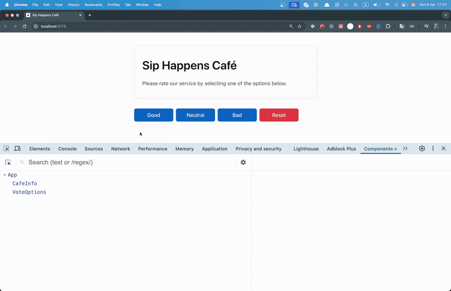
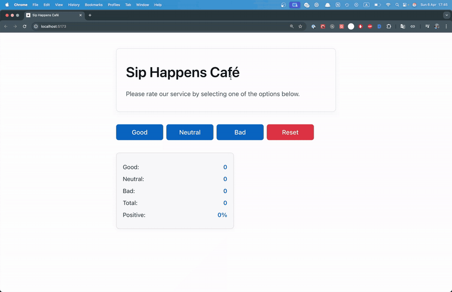
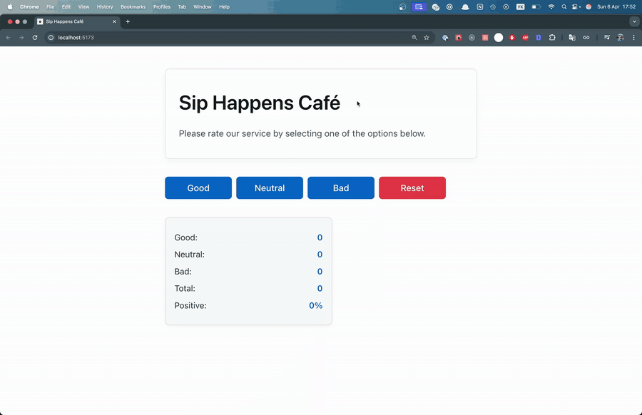
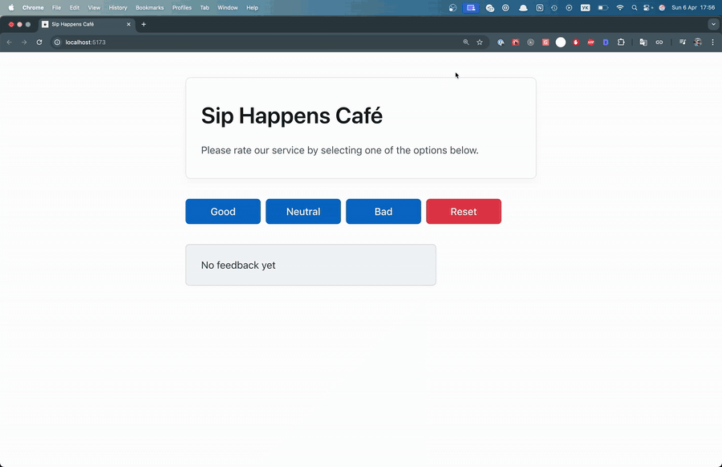

<p align="center">
  <a href="README.md">English</a> | <a href="README.ru.md">Русский</a> | <b>Українська</b> | <a href="README.es.md">Español</a>
</p>


# Віджет відгуків — Sip Happens Café


## Про проєкт

Односторінковий застосунок: відвідувач оцінює кав’ярню (**Good / Neutral / Bad**)
і одразу бачить статистику — кількість голосів за кожен варіант, загальну
кількість голосів і відсоток позитивних відгуків. Поки голосів немає,
показується повідомлення «No feedback yet»; кнопка **Reset** з’являється лише
після першого голосу й скидає результати.


### Що прокачуєш

| Навичка                            | Де використовується в задачі                                     |
| ---------------------------------- | ---------------------------------------------------------------- |
| Функціональні компоненти та JSX    | `App`, `CafeInfo`, `VoteOptions`, `VoteStats`, `Notification`    |
| Композиція компонентів             | усі компоненти рендеряться всередині `App`                       |
| Пропси                             | передача даних і колбеків з `App` у дочірні компоненти           |
| Типізація пропсів (`interface`)    | `VoteOptionsProps`, `VoteStatsProps`                             |
| Спільні TS-типи, union-типи        | `Votes`, `VoteType = 'good' \| 'neutral' \| 'bad'` у `src/types` |
| `useState` з об’єктом              | стан `votes` `{ good, neutral, bad }`                            |
| Іммутабельне оновлення стану       | `handleVote(type)` — spread + обчислюваний ключ `[type]`         |
| Підйом стану (lifting state up)    | стан в `App`, діти отримують його через пропси                   |
| Обробка подій                      | `onClick` на кнопках → `onVote` / `onReset`                      |
| Похідні дані                       | `totalVotes` і `positiveRate` обчислюються, а не зберігаються    |
| Умовний рендеринг                  | `VoteStats` або `Notification`, кнопка Reset через `canReset`    |
| CSS-модулі                         | `*.module.css` для кожного компонента, `modern-normalize`        |

---

## Завдання

Створи застосунок, який дозволяє користувачам залишати відгуки про кав’ярню.
Є три варіанти оцінки: **good**, **neutral**, **bad**. Користувач обирає одну з
опцій і бачить статистику.

## Загальні вимоги

- У кожній папці компонента мають бути:
  - файл компонента з розширенням `.tsx` (наприклад, `App.tsx`);
  - файл стилів з такою самою назвою, що закінчується на `.module.css`
    (наприклад, `App.module.css`).
- Для експорту компонентів використовується експорт за замовчуванням
  (`export default`).
- Загальні типи, які використовуються в кількох компонентах, винесені в окремий
  файл `src/types/votes.ts`. Типи та інтерфейси, які стосуються лише одного
  компонента, оголошені безпосередньо у файлі цього компонента.
- TypeScript-код має бути чистим, зрозумілим і відформатованим за допомогою
  Prettier.
- Стилізація виконується за допомогою CSS-модулів.
- Використовується `modern-normalize` для уніфікації стилів у різних браузерах.

## Компоненти

Інтерфейс уже розділено на компоненти, надано готову HTML-розмітку й стилі.
Задача — сфокусуватися на логіці в React і TypeScript: зібрати інтерфейс,
реалізувати функціональність і виконати типізацію.

Стилі для всіх компонентів скопіюй із репозиторію
[goitacademy/react-cafe-styles](https://github.com/goitacademy/react-cafe-styles).
Після створення компонентів скопіюй відповідні `.module.css` файли у відповідні
папки в `src/components`.

Усі компоненти рендеряться всередині компонента `App`.


```
src/
├── components/
│   ├── App/            App.tsx, App.module.css
│   ├── CafeInfo/       CafeInfo.tsx, CafeInfo.module.css
│   ├── VoteOptions/    VoteOptions.tsx, VoteOptions.module.css
│   ├── VoteStats/      VoteStats.tsx, VoteStats.module.css
│   └── Notification/   Notification.tsx, Notification.module.css
└── types/
    └── votes.ts
```

---

## Крок 1. Компонент `App`

`App` — контейнер для решти компонентів. Поки що створює таку розмітку:

```jsx
<div className={css.app}></div>
```

## Крок 2. Компонент `CafeInfo`

Компонент із назвою та коротким описом кав’ярні:

```jsx
<div className={css.container}>
  <h1 className={css.title}>Sip Happens Café</h1>
  <p className={css.description}>
    Please rate our service by selecting one of the options below.
  </p>
</div>
```

Додай його до `App`. Після цього кроку інтерфейс має виглядати так:


## Крок 3. Стан додатка

При кліку на кнопки **Good / Neutral / Bad** з компонента `VoteOptions` треба
зберігати вибір користувача та передавати його іншим компонентам, зокрема
`<VoteStats />`.

Створи в `App` стан `votes`:

```ts
{
  good: 0,
  neutral: 0,
  bad: 0
}
```

Типізуй стан через інтерфейс `Votes`, оголошений та експортований у
`src/types/votes.ts`. У цьому ж файлі створи тип `VoteType` —
`'good' | 'neutral' | 'bad'`.

Додай у `App` функції:

- `handleVote(type)` — оновлює стан голосів; параметр типізований через `VoteType`;
- `resetVotes()` — скидає стан.

`votes` — центральне джерело даних; компоненти отримують актуальні значення
через пропси.

## Крок 4. Компонент `VoteOptions`

Рендерить кнопки для голосування та кнопку Reset:

```jsx
<div className={css.container}>
  <button className={css.button}>Good</button>
  <button className={css.button}>Neutral</button>
  <button className={css.button}>Bad</button>
  <button className={`${css.button} ${css.reset}`}>Reset</button>
</div>
```

Пропси:

| Пропс      | Тип                        | Опис                                                     |
| ---------- | -------------------------- | -------------------------------------------------------- |
| `onVote`   | `(type: VoteType) => void` | викликається при кліку на кнопку голосування             |
| `onReset`  | `() => void`               | викликається при кліку на Reset, скидає голоси           |
| `canReset` | `boolean`                  | чи показувати кнопку Reset (на цьому етапі можна `true`) |

У файлі компонента оголоси інтерфейс `VoteOptionsProps`. Кнопки мають оновлювати
стан в `App`.

Після цього кроку застосунок має працювати так:



## Крок 5. Компонент `VoteStats`

Відображає статистику голосів:

```jsx
<div className={styles.container}>
  <p className={styles.stat}>
    Good: <strong>0</strong>
  </p>
  <p className={styles.stat}>
    Neutral: <strong>0</strong>
  </p>
  <p className={styles.stat}>
    Bad: <strong>0</strong>
  </p>
  <p className={styles.stat}>
    Total: <strong>0</strong>
  </p>
  <p className={styles.stat}>
    Positive: <strong>0%</strong>
  </p>
</div>
```

Пропси:

| Пропс          | Тип      | Опис                                         |
| -------------- | -------- | -------------------------------------------- |
| `votes`        | `Votes`  | кількість голосів для good, neutral, bad     |
| `totalVotes`   | `number` | загальна кількість голосів (поки можна `0`)  |
| `positiveRate` | `number` | відсоток позитивних голосів (поки можна `0`) |

У файлі компонента оголоси інтерфейс `VoteStatsProps`. При кліках на кнопки в
`VoteOptions` зміни мають відображатися у `VoteStats`.

Після цього кроку застосунок має працювати так:



## Крок 6. Обчислення статистики

Обчислення виконуються в `App`, готові значення передаються пропсами у
`VoteStats`.

```ts
const totalVotes = votes.good + votes.neutral + votes.bad;

const positiveRate = totalVotes
  ? Math.round((votes.good / totalVotes) * 100)
  : 0;
```

> Для `totalVotes` і `positiveRate` **не потрібно** створювати окремі властивості
> в стані — це похідні дані.

Після цього кроку застосунок має працювати так:



## Крок 7. Компонент `Notification`

Показує повідомлення про відсутність статистики. Пропсів не приймає:

```jsx
<p className={css.message}>No feedback yet</p>
```

Умовний рендеринг залежно від `totalVotes`:

- `totalVotes > 0` → рендериться `VoteStats`;
- `totalVotes === 0` → рендериться `Notification`.

Після цього кроку застосунок має працювати так:



## Крок 8. Кнопка Reset за умови

Кнопка Reset відображається тільки коли є хоча б один голос. Використай
`totalVotes` в `App` і передай відповідне значення пропсом `canReset` у
`VoteOptions`.

Після цього кроку застосунок завершено, і він має працювати так:


---

## Здача на перевірку

Розв’язав задачу й хочеш, щоб я перевірив? Ось кроки та умови.

**Вимоги до рішення**

- [ ] Виконано всі кроки 1–8, відмічено всі пункти чекліста нижче.
- [ ] `npm run build` і `npm run lint` проходять без помилок.
- [ ] Код відформатовано Prettier.
- [ ] Застосунок перевірено в браузері: голосування, статистика, `Notification` і Reset працюють.
- [ ] *(Необов’язково)* Застосунок задеплоєно (Vercel / Netlify / GitHub Pages), посилання додано в PR.

**Як здати**

1. Зроби **Fork** цього репозиторію (кнопка праворуч угорі на GitHub).
2. Склонуй свій форк і створи свою гілку від гілки задачі:
   ```bash
   git clone https://github.com/<твій-нік>/react.git
   cd react
   git checkout task-01-cafe-feedback
   git checkout -b task-01-cafe-feedback-<твій-нік>
   npm install
   npm run dev
   ```
3. Розв’яжи задачу, закоміть і запуш гілку у свій форк:
   ```bash
   git push -u origin task-01-cafe-feedback-<твій-нік>
   ```
4. Відкрий **Pull Request** у цей репозиторій:
   - **base:** `task-01-cafe-feedback` (гілка задачі, **не** `main`);
   - **compare:** твоя гілка з форку;
   - назва: `Рішення task-01 — <твій-нік>`;
   - заповни шаблон PR (він підставиться сам).
5. Я перегляну код і залишу коментарі прямо в PR.

PR **не мерджиться**, щоб гілка задачі залишалася чистою для наступних
проходжень. Після рев’ю я закрию PR, а твоє рішення залишиться у твоєму форку.

## Чекліст

- [ ] Крок 1 — `App`
- [ ] Крок 2 — `CafeInfo`
- [ ] Крок 3 — стан `votes`, типи `Votes` і `VoteType`
- [ ] Крок 4 — `VoteOptions`
- [ ] Крок 5 — `VoteStats`
- [ ] Крок 6 — `totalVotes` і `positiveRate`
- [ ] Крок 7 — `Notification` і умовний рендеринг
- [ ] Крок 8 — Reset за умови
